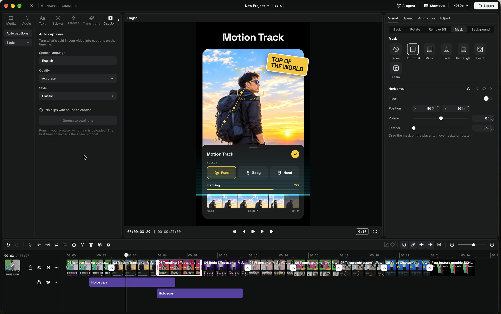
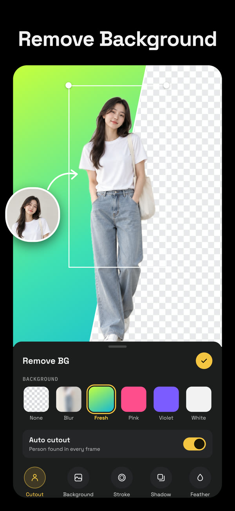
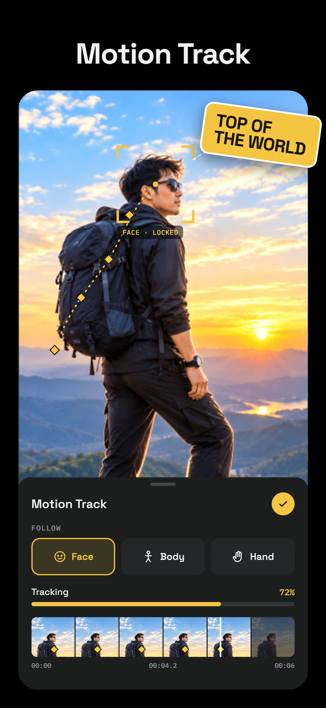
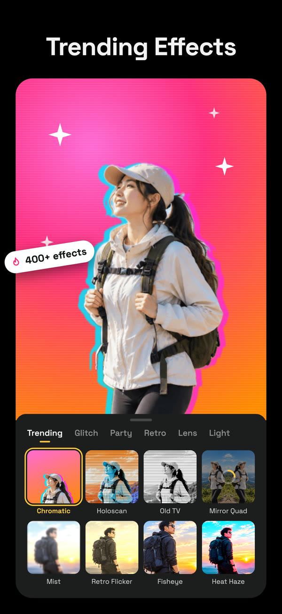
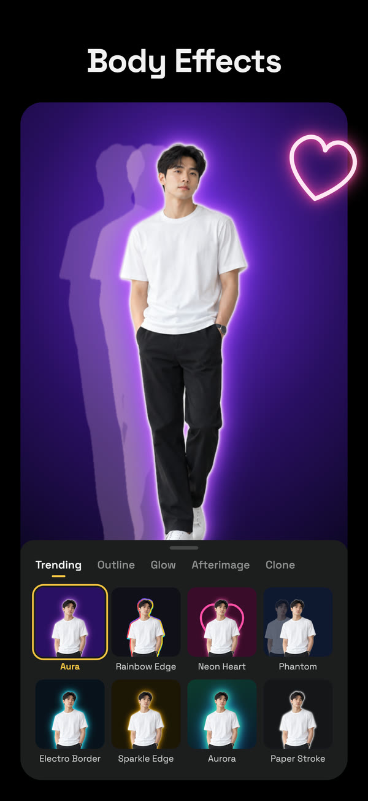
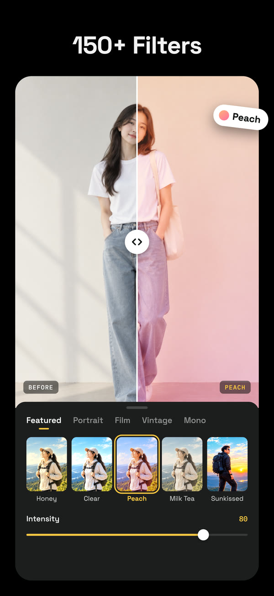
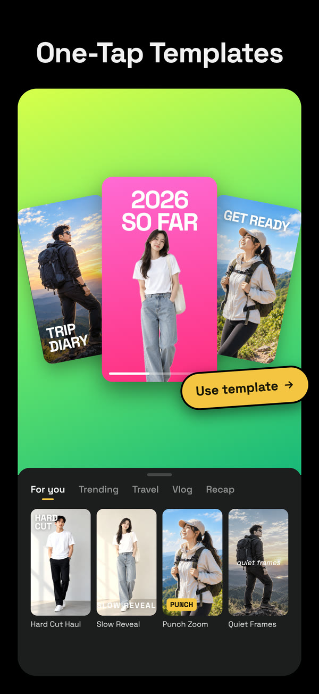
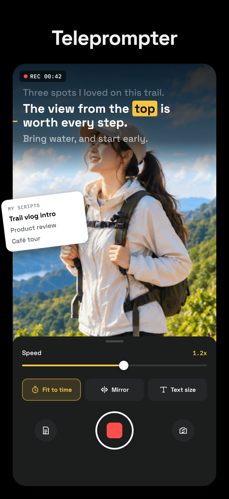
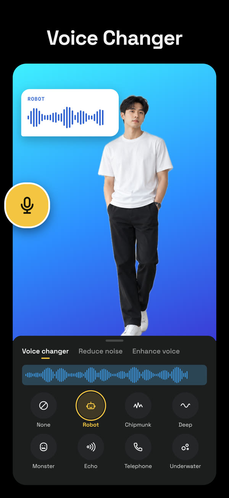

<div align="center">


# Reel Studio

**Free video & photo editor for creators — on your phone and on your desktop.**

Timeline editing, trending effects, auto captions and one-click background removal, with AI that runs on your device.

[](https://github.com/rothxz/reel-studio-desktop/releases/latest)
[](https://github.com/rothxz/reel-studio-desktop/releases)


[**Download for desktop**](https://github.com/rothxz/reel-studio-desktop/releases/latest) ·
[**Google Play**](https://play.google.com/store/apps/details?id=com.reelstudio.app) ·
**App Store** (in review) ·
[**Website**](https://reel-studio.expo.app)

<br />



</div>

## Download

| Platform | Get it | Notes |
| --- | --- | --- |
| **macOS** (Apple Silicon) | [`Reel-Studio-<version>-mac-arm64.dmg`](https://github.com/rothxz/reel-studio-desktop/releases/latest) | Signed & notarized by Apple |
| **macOS** (Intel) | [`Reel-Studio-<version>-mac-x64.dmg`](https://github.com/rothxz/reel-studio-desktop/releases/latest) | Signed & notarized by Apple |
| **Windows** 10 / 11 (64-bit) | [`Reel-Studio-<version>-win-x64.exe`](https://github.com/rothxz/reel-studio-desktop/releases/latest) | Installer; see [first launch](#first-launch) |
| **Linux** (x86_64) | [`Reel-Studio-<version>-linux-x86_64.AppImage`](https://github.com/rothxz/reel-studio-desktop/releases/latest) | Portable AppImage, no install |
| **Android** | [Google Play](https://play.google.com/store/apps/details?id=com.reelstudio.app) | Available now |
| **iPhone** | App Store | In review, coming soon |

The desktop apps update themselves: when a new version is out, Reel Studio offers to download it and restart.

## On your phone

<p align="center">
  
  
  
  
</p>
<p align="center">
  
  
  
  
</p>

## Features

### Edit

- **Multi-track timeline**: video, overlay, text, sticker, effect and audio lanes. Split, trim, move between lanes, magnet snapping, and per-lane lock, hide and mute.
- **Keyframes on everything**: position, scale, rotation, opacity, colour adjustments, masks, volume and text colour, with custom easing curves.
- **Speed**: constant speed or curve ramps; freeze frame; reverse.
- **Masks**: horizontal, mirror, circle, rectangle, heart and star, with feather, invert and keyframes.
- **Background**: colour, image or blur fill for any aspect ratio (9:16, 16:9, 1:1, 4:5…).
- **Text & stickers**: styles, stroke, glow, shadow, curved text, In/Out/Loop text animations and text templates.
- **Transitions** between clips and **In / Out / Combo** clip animations.

### Effects & looks

- **400+ trending effects**: glitch, party, retro, lens, light and more, plus new effects delivered without an app update.
- **Body effects**: glows, outlines, afterimages and clones that follow the person in the shot *(mobile)*.
- **150+ filters** with intensity, plus Adjust (exposure, contrast, saturation, temperature, …).
- **One-tap templates**: drop in your clips and get an edited video *(mobile)*.

### AI, on your device

- **Remove background** from video and photos, with no green screen. Add an outline stroke, or refine with the brush.
- **Auto captions**: speech to timed captions with caption styles and a transcript editor. English, Khmer, Vietnamese, Chinese and Indonesian on mobile, and English on desktop.
- **Motion track**: text and stickers follow a face, body or hand *(mobile)*.
- **Voice tools**: reduce noise, enhance voice and voice changer *(mobile)*.
- **Teleprompter**: record to camera while your script scrolls *(mobile)*.

Your videos stay on your device. Background removal, captions and tracking run locally, and nothing is uploaded to process them.

### Desktop

- A full-screen layout for big monitors: media browser, player, inspector and timeline in resizable panels.
- Keyboard shortcuts for the timeline, plus right-click menus and copy/paste of clips.
- **AI agent** *(beta)*: describe an edit in plain words and it runs it on your timeline. Works with a local model (Ollama, LM Studio) or your own Claude, ChatGPT or Gemini key, which is kept in the system keychain. It can also *look* at your footage to find the right moments.
- Export **MP4 up to 4K** at 24, 30 or 60 fps.

### Languages

English · ខ្មែរ (Khmer) · Tiếng Việt · 简体中文 · Bahasa Indonesia

## First launch

- **macOS**: open the `.dmg` and drag Reel Studio to Applications. The app is notarized by Apple, so it opens like any other app.
- **Windows**: the installer is not code-signed yet, so Windows SmartScreen may warn you. Click **More info → Run anyway**.
- **Linux**: make the AppImage executable, then run it:

  ```sh
  chmod +x Reel-Studio-*-linux-x86_64.AppImage
  ./Reel-Studio-*-linux-x86_64.AppImage
  ```

### System requirements

| | Minimum |
| --- | --- |
| macOS | 12 Monterey or later, Apple Silicon or Intel |
| Windows | Windows 10 or 11, 64-bit |
| Linux | x86_64 desktop with a recent glibc (Ubuntu 22.04+, Fedora 38+ or similar) |
| Memory | 8 GB RAM recommended for 4K editing |

## Feedback

Found a bug or have an idea? [Open an issue](https://github.com/rothxz/reel-studio-desktop/issues). Please include your OS, the app version and steps to reproduce.

## About this repository

This repository hosts the **public releases** of Reel Studio for desktop. The installed apps check it for updates. The app's source code is not published here.

<div align="center">
<sub>© 2026 Reel Studio. All rights reserved.</sub>
</div>
