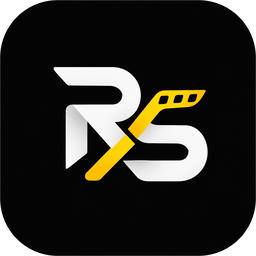
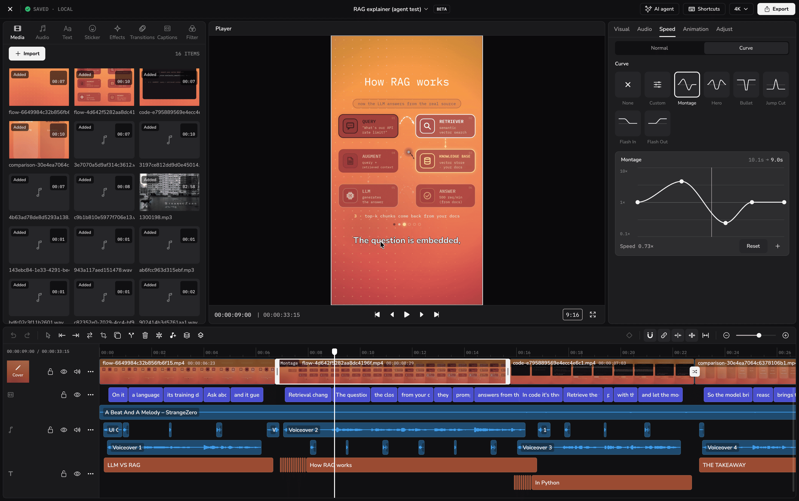
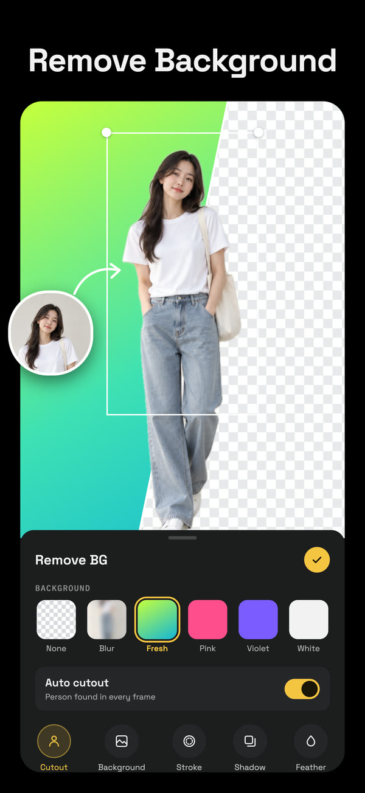
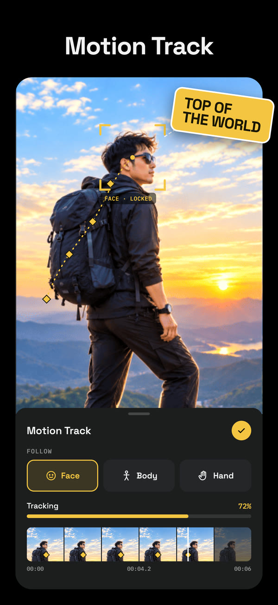
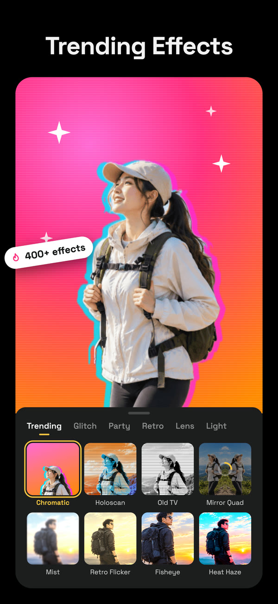
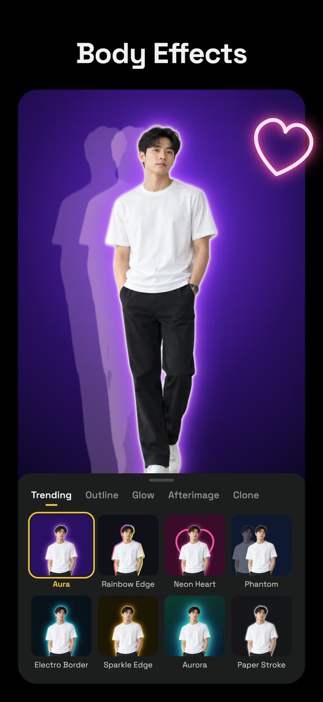
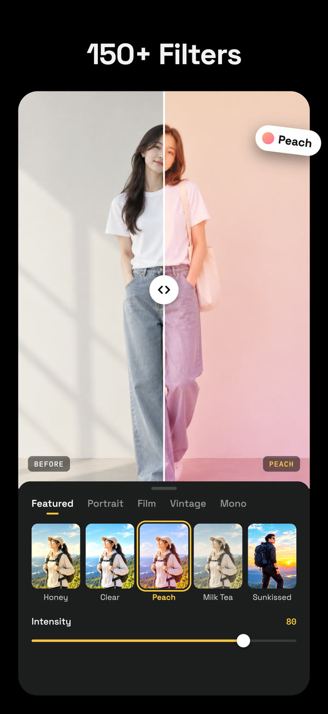
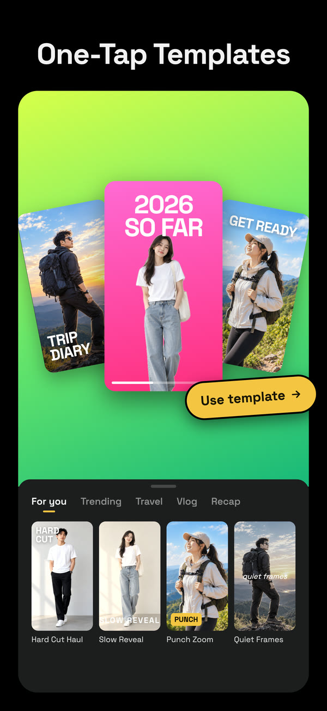
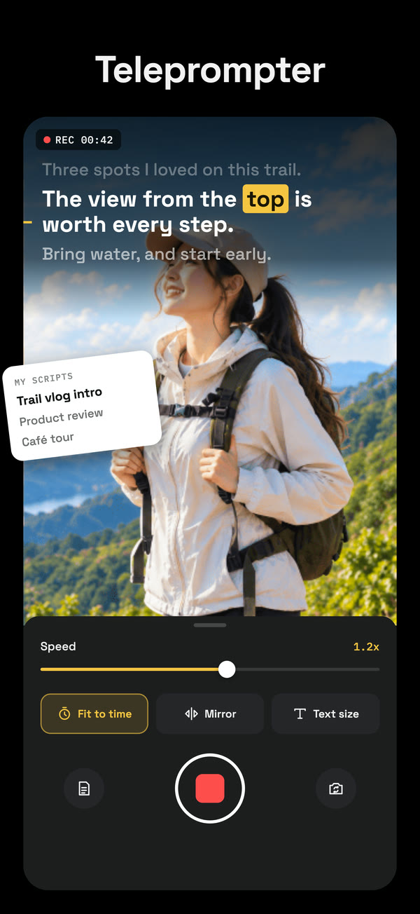
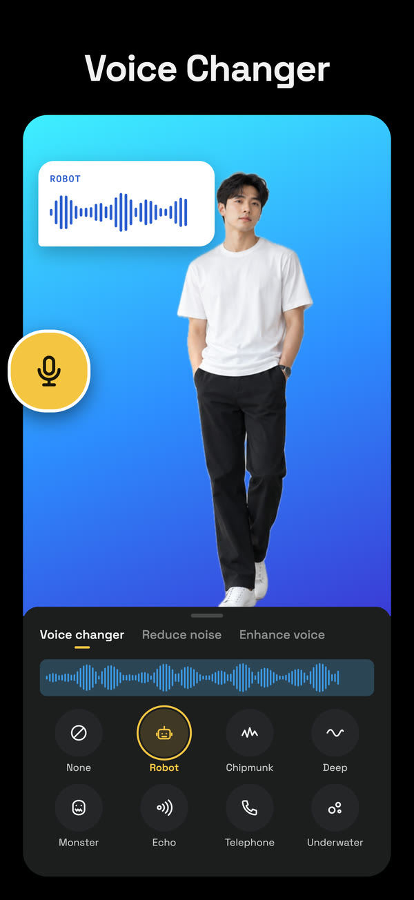

<div align="center">



# Reel Studio

**Free video & photo editor for creators — on your phone and on your desktop.**

Timeline editing, trending effects, auto captions and one-click background removal, with AI that runs on your device.

[](https://github.com/rothxz/reel-studio-app/releases/latest)
[](https://github.com/rothxz/reel-studio-app/releases)

[](https://github.com/rothxz/reel-studio-app/releases/latest/download/Reel-Studio-mac-arm64.dmg)
[](https://github.com/rothxz/reel-studio-app/releases/latest/download/Reel-Studio-windows-x64-setup.exe)
[](https://github.com/rothxz/reel-studio-app/releases/latest/download/Reel-Studio-linux-x64.AppImage)
<br />
[](https://play.google.com/store/apps/details?id=com.reelstudio.app)
[](#download)

[Website](https://reel-studio.expo.app) · [All releases](https://github.com/rothxz/reel-studio-app/releases)

<br />



</div>

## Download

| Platform                     | Get it                                                       | Notes                                        |
| ---------------------------- | ------------------------------------------------------------ | -------------------------------------------- |
| **macOS** (Apple Silicon)    | [Download `.dmg`](https://github.com/rothxz/reel-studio-app/releases/latest/download/Reel-Studio-mac-arm64.dmg)                 | Signed & notarized by Apple                  |
| **macOS** (Intel)            | [Download `.dmg`](https://github.com/rothxz/reel-studio-app/releases/latest/download/Reel-Studio-mac-x64.dmg)                   | Signed & notarized by Apple                  |
| **Windows** 10 / 11 (64-bit) | [Download installer](https://github.com/rothxz/reel-studio-app/releases/latest/download/Reel-Studio-windows-x64-setup.exe)      | See [first launch](#first-launch)            |
| **Linux** (x86_64)           | [`.deb`](https://github.com/rothxz/reel-studio-app/releases/latest/download/Reel-Studio-linux-amd64.deb) · [`.rpm`](https://github.com/rothxz/reel-studio-app/releases/latest/download/Reel-Studio-linux-x86_64.rpm) · [`.AppImage`](https://github.com/rothxz/reel-studio-app/releases/latest/download/Reel-Studio-linux-x64.AppImage) | `.deb` Ubuntu / Debian, `.rpm` Fedora / openSUSE, AppImage needs no install |
| **Linux** (ARM64)            | [`.deb`](https://github.com/rothxz/reel-studio-app/releases/latest/download/Reel-Studio-linux-arm64.deb) · [`.rpm`](https://github.com/rothxz/reel-studio-app/releases/latest/download/Reel-Studio-linux-aarch64.rpm) · [`.AppImage`](https://github.com/rothxz/reel-studio-app/releases/latest/download/Reel-Studio-linux-arm64.AppImage) | Same, for ARM64 |
| **Android**                  | [Google Play](https://play.google.com/store/apps/details?id=com.reelstudio.app)                            | Available now                                |
| **iPhone**                   | App Store                                                                                                  | In review, coming soon                       |

Portable `.zip` / `.tar.gz` builds and older versions are on [All releases](https://github.com/rothxz/reel-studio-app/releases). The desktop apps update themselves: when a new version is out, Reel Studio offers to download it and restart.

## On your phone

<p align="center">
  
  
  
  
</p>
<p align="center">
  
  
  
  
</p>

## Features

### Edit

- **Multi-track timeline**: video, overlay, text, sticker, effect and audio lanes. Split, trim, move between lanes, magnet snapping, and per-lane lock, hide and mute.
- **Keyframes on everything**: position, scale, rotation, opacity, colour adjustments, masks, volume and text colour, with custom easing curves.
- **Speed**: constant speed or curve ramps; freeze frame; reverse.
- **Masks**: horizontal, mirror, circle, rectangle, heart and star, with feather, invert and keyframes.
- **Background**: colour, image or blur fill for any aspect ratio (9:16, 16:9, 1:1, 4:5…).
- **Text & stickers**: styles, stroke, glow, shadow, curved text, In/Out/Loop text animations and text templates.
- **Transitions** between clips and **In / Out / Combo** clip animations.

### Effects & looks

- **400+ trending effects**: glitch, party, retro, lens, light and more, plus new effects delivered without an app update.
- **Body effects**: glows, outlines, afterimages and clones that follow the person in the shot _(mobile)_.
- **150+ filters** with intensity, plus Adjust (exposure, contrast, saturation, temperature, …).
- **One-tap templates**: drop in your clips and get an edited video _(mobile)_.

### AI, on your device

- **Remove background** from video and photos, with no green screen. Add an outline stroke, or refine with the brush.
- **Auto captions**: speech to timed captions with caption styles and a transcript editor. English, Khmer, Vietnamese, Chinese and Indonesian on mobile, and English on desktop.
- **Motion track**: text and stickers follow a face, body or hand _(mobile)_.
- **Voice tools**: reduce noise, enhance voice and voice changer _(mobile)_.
- **Teleprompter**: record to camera while your script scrolls _(mobile)_.

Your videos stay on your device. Background removal, captions and tracking run locally, and nothing is uploaded to process them.

### Desktop

- A full-screen layout for big monitors: media browser, player, inspector and timeline in resizable panels.
- Keyboard shortcuts for the timeline, plus right-click menus and copy/paste of clips.
- **AI agent** _(beta)_: describe an edit in plain words and it runs it on your timeline. Works with a local model (Ollama, LM Studio) or your own Claude, ChatGPT or Gemini key, which is kept in the system keychain. It can also _look_ at your footage to find the right moments.
- Export **MP4 up to 4K** at 24, 30 or 60 fps.

### Languages

English · ខ្មែរ (Khmer) · Tiếng Việt · 简体中文 · Bahasa Indonesia

## First launch

- **macOS**: open the `.dmg` and drag Reel Studio to Applications. The app is notarized by Apple, so it opens like any other app.
- **Windows**: the installer is not code-signed yet, so Windows SmartScreen may warn you. Click **More info → Run anyway**.
- **Linux**, pick one:
  - **Ubuntu, Debian, Mint, Pop!_OS**: open the `.deb` with Software Install, or
    ```sh
    sudo apt install ./Reel-Studio-linux-amd64.deb
    ```
  - **Fedora, RHEL**: `sudo dnf install ./Reel-Studio-linux-x86_64.rpm`
  - **openSUSE**: `sudo zypper install --allow-unsigned-rpm ./Reel-Studio-linux-x86_64.rpm`
  - **Any distribution, no install**: make the AppImage executable and run it. Only the AppImage updates itself; for a `.deb` / `.rpm`, install the new version's package over the old one.
    ```sh
    chmod +x Reel-Studio-linux-x64.AppImage
    ./Reel-Studio-linux-x64.AppImage
    ```
    If it doesn't start (no FUSE on the system), run it with `--appimage-extract-and-run`.

  Installed from a `.deb` or `.rpm`, Reel Studio appears in the app menu.

### System requirements

|         | Minimum                                                                   |
| ------- | ------------------------------------------------------------------------- |
| macOS   | 12 Monterey or later, Apple Silicon or Intel                              |
| Windows | Windows 10 or 11, 64-bit                                                  |
| Linux   | x86_64 or ARM64 desktop, X11 or Wayland, glibc 2.35+ (Ubuntu 22.04+, Debian 12+, Fedora 38+ or similar) |
| Memory  | 8 GB RAM recommended for 4K editing                                       |

## Feedback

Found a bug or have an idea? [Open an issue](https://github.com/rothxz/reel-studio-app/issues). Please include your OS, the app version and steps to reproduce.

## About this repository

This repository hosts the **public releases** of Reel Studio for desktop. The installed apps check it for updates. The app's source code is not published here.

<div align="center">
<sub>© 2026 Reel Studio. All rights reserved.</sub>
</div>
