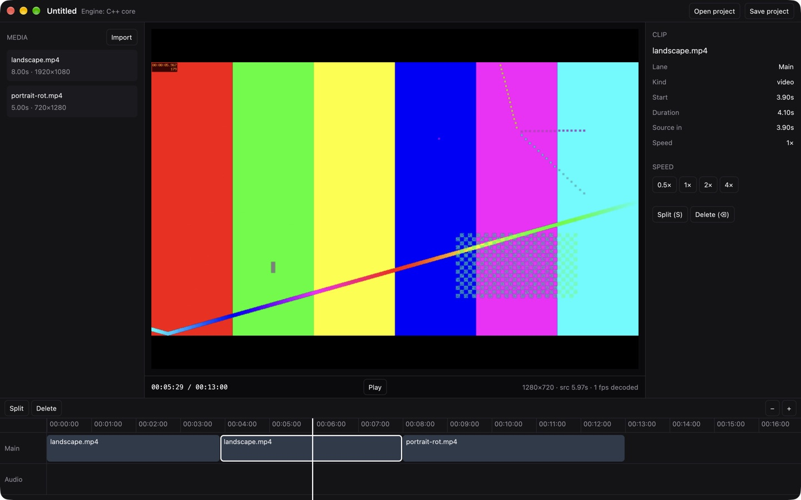

# Reel Studio desktop on GPUI: experiment

Can the desktop editor leave Electron for a native Rust app built on
[GPUI](https://www.gpui.rs) (the UI framework behind the Zed editor)? This
folder is a working spike that tries to answer that. It is **not** the shipping
desktop app. Releases on this repo are still the Electron build.



## What it does

- Uses the desktop editor's layout in a native window: media library | player |
  inspector, with a timeline below.
- Imports video files (Import button, ⌘I, drag and drop, or command-line
  args) and probes them with FFmpeg.
- Previews video by decoding in-process (ffmpeg-next) on one thread per source
  file. The frame lands in GPUI as a GPU texture. Requests are "latest wins",
  so a fast scrub decodes only the frame it stops on. Playback decodes forward
  without re-seeking. Phone clips with a rotation flag are turned upright,
  checked against FFmpeg's own auto-rotate.
- Supports these edits: append, split (S), delete (⌫, the main lane closes
  the gap), speed 0.5×/1×/2×/4× (later clips shift), select, and scrub/zoom
  the timeline.
- Opens and saves projects as JSON in the **same document format the app
  uses** (`Project` / `Track` / `Clip`). Fields this spike doesn't know about
  (keyframes, effects, masks…) are kept and written back untouched.
- Can run on the **shared C++ engine** (`--features cpp-engine`). Rust then
  drives the same `videoengine::Engine` the iOS/Android apps link, through a
  ~100-line C shim (`engine-shim/reel_engine.cpp`). The engine is the
  playback clock, and the preview asks it which clips are visible and what
  source time to show (`FindActiveClips` + `ClipOffsetToSourceTime`, so
  speed curves, reverse and freeze come for free). Without the feature, a
  small Rust stand-in keeps the crate buildable from this repo alone.

## Run it

```sh
brew install ffmpeg pkg-config        # FFmpeg 9 (ffmpeg-next 9 matches it)
cargo run --release -- ~/Movies/a.mp4 ~/Movies/b.mov

# With the shared C++ engine. Its source lives in the private app repo and
# is not copied here: point at that checkout's engine folder.
REEL_ENGINE_DIR=/path/to/reel-studio/modules/video-engine/cpp \
  cargo run --release --features cpp-engine

cargo test                            # model + engine tests (either backend)

# In the ~/Project workspace layout (reel-studio next to reel-studio-app),
# .cargo/config.toml already points REEL_ENGINE_DIR there:
cargo dev ~/Movies/a.mp4              # run --release --features cpp-engine
cargo t                               # tests on the C++ engine
```

Working on it: `/CLAUDE.md` is the context (rules, architecture, where each
part of the old editor lives), and `docs/PARITY.md` tracks what's done.

Keys: Space play/pause · S split · ⌫ delete · ←/→ one frame · Home start ·
⌘=/⌘- zoom · ⌘I import · ⌘O open project · ⌘S save project.

## What we measured (M-series Mac, macOS 27, release build)

| | GPUI spike | Electron app today |
| --- | --- | --- |
| App size | 9.1 MB binary (+ FFmpeg dylibs, ~15–25 MB if bundled trimmed) | 284 MB `.app` |
| Memory, 2 clips open, after playback | ~180–250 MB RSS | (not measured here) |
| Playback, 1080p + 720p H.264 across a cut | 30 fps, ~35–60 % of one core | n/a |

The CPU figure is **software** decode plus a CPU colour conversion. FFmpeg's
VideoToolbox hwaccel, and handing GPUI the hardware frames directly, are the
obvious next steps and should cut it sharply.

## Verdict

**Feasible, and the native engine fits well.** GPUI builds from crates.io
(`gpui 0.2.2`), plays 30 fps footage in real time, and pulls in the C++ core with a plain
`cc` build: no React Native, no web view. The pieces that make this editor
hard (playback clock, timeline math, the project document) moved over with
almost no new code because they were already engine-side or plain data.

**The cost is the UI and the preview, not the engine.** The editor in the main
repo is ~190k lines of TypeScript/React. Nothing of it runs in GPUI; every
panel, sheet and gesture is a rewrite in Rust. The biggest items:

| Area | Today (web/Electron) | In a GPUI app |
| --- | --- | --- |
| Preview compositor (effects, filters, masks, transitions, text) | CanvasKit + SkSL runtime shaders | Reuse the native Metal compositor (`ios/MetalCompositor.mm`, no UIKit) on macOS; Windows/Linux need a GL/wgpu port (the Android GLES shaders are a start). Effects packages already compile to Metal/GLSL. |
| Export | WebCodecs + mediabunny (TS port of the engine) | The C++ `Engine::RunExportJob` with desktop decoder/encoder. On macOS `AVFoundationDecoder`/`VideoToolboxEncoder` are nearly portable (only 2 of 12 iOS `.mm` files touch UIKit); elsewhere FFmpeg. |
| Text, captions, text animations | Skia Paragraph + shared `draw.ts` | GPUI text is fine for UI, but the canvas text needs Skia (`skia-safe`) or a port of `draw.ts`. |
| Audio playback + waveform | Web Audio | `cpal` + the engine's `AudioMixer` |
| AI tools (captions, Remove BG, …) | Transformers.js workers | `ort` / `candle`, or the native models the phone apps already use |
| Widgets (inputs, sliders, menus, dialogs) | React components | `gpui-component` (0.9) covers most; GPUI is still pre-1.0 and its API moves. |
| Languages incl. Khmer | i18n + Kantumruy Pro | Bundle fonts; GPUI shapes text with Core Text / DirectWrite, so Khmer should work but is unverified. |
| Auto-update, installers | electron-builder + electron-updater | `cargo-packager` (or similar) + an updater; the release workflow changes. |

**Suggested path if we go ahead:**

1. macOS first. Link the existing Metal compositor and AVFoundation/VideoToolbox
   decode + encode into this app through the C++ engine, so preview and export
   match the phone apps exactly.
2. Build the editor UI panel by panel on `gpui-component`, keeping the JSON
   document so projects move between the web, phone and native apps.
3. Windows/Linux after that, on an FFmpeg + GL/wgpu backend for the engine.

Until step 1 lands, the Electron app stays the one people download.

## Layout

```
src/main.rs        window, menus, key bindings
src/editor.rs      the editor view (library, player, inspector, timeline)
src/model.rs       project document (serde, round-trips unknown fields)
src/engine.rs      engine binding: C++ core (feature) or Rust stand-in
src/decoder.rs     FFmpeg probe + per-file decode threads → BGRA frames
engine-shim/       C ABI over videoengine::Engine (compiled by build.rs)
```
