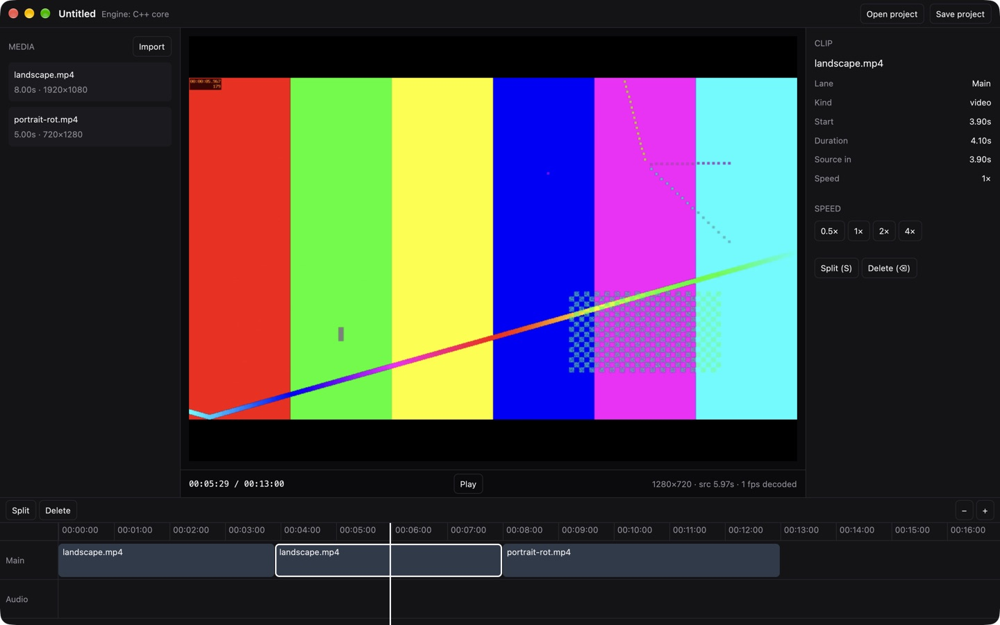

# Reel Studio desktop on GPUI

The desktop editor, reimplemented as a native Rust app on
[GPUI](https://www.gpui.rs) (the UI framework behind the Zed editor), to
replace the Electron build. Until it ships, releases on this repo are still
the Electron build.



## What it does

- Opens on a **projects home** (greeting, New video, Recent list). New video
  takes files from a dialog or a drop; projects are JSON files in the app's
  data folder, saved shortly after each edit, on close and on quit.
- The editor follows the old desktop editor's layout and look: header (✕,
  save state, name, Beta, Shortcuts, resolution, Export), browser | player
  | inspector over the timeline toolbar and timeline, with draggable,
  remembered gutters. Same palette, Nunito / IBM Plex Mono, and the same
  icon glyphs.
- Browser: the eight tabs, with a Media library of thumbnail tiles (Added
  badge, length); a click inserts the file at the playhead.
- Player: the project canvas fitted in the panel, HH:MM:SS:FF timecode,
  go to start / frame back / play / frame forward / go to end, ratio menu,
  full-screen preview. Frames are decoded in-process (ffmpeg-next), one
  thread per source, latest request wins; rotation flags are applied.
- Inspector: project Details, or the selected clip's tabs per kind (Speed ›
  Normal is the first working panel).
- Timeline toolbar and timeline: undo / redo, Select / Split tool, delete
  left / right, split / delete / duplicate, main track magnet + linkage,
  zoom slider and fit; lanes with lock / eye / mute, ruler, playhead.
- Every shortcut of the old editor (one table drives keys, menus, tooltips
  and the Shortcuts dialog, ⌘/), and undo for every edit.
- The document is the **same JSON the app uses**; fields not edited here
  (keyframes, effects, masks…) are kept and written back untouched.
- Runs on the **shared C++ engine** (`--features cpp-engine`) through a
  small C shim (`engine-shim/reel_engine.cpp`): playback clock, which clips
  are visible and their source times (speed curves, reverse, freeze). A
  Rust stand-in keeps the crate buildable from this repo alone.

`docs/PARITY.md` lists what is done and what isn't, item by item.

## Run it

```sh
brew install ffmpeg pkg-config        # FFmpeg 9 (ffmpeg-next 9 matches it)
cargo run --release -- ~/Movies/a.mp4 ~/Movies/b.mov

# With the shared C++ engine. Its source lives in the private app repo and
# is not copied here: point at that checkout's engine folder.
REEL_ENGINE_DIR=/path/to/reel-studio/modules/video-engine/cpp \
  cargo run --release --features cpp-engine

cargo test                            # model + engine tests (either backend)

# In the ~/Project workspace layout (reel-studio next to reel-studio-app),
# .cargo/config.toml already points REEL_ENGINE_DIR there:
cargo dev ~/Movies/a.mp4              # run --release --features cpp-engine
cargo t                               # tests on the C++ engine
```

Working on it: `/CLAUDE.md` is the context (rules, architecture, where each
part of the old editor lives), and `docs/PARITY.md` tracks what's done.

Keys are the old editor's (⌘/ lists them): Space play · ⌘B split · ⌫
delete · Q / W delete left / right · ⌘Z / ⌘⇧Z undo / redo · ←/→ frame ·
↑/↓ edit point · ⌘= / ⌘- / ⇧Z zoom · ⌘I import · ⌘O import a project JSON
· ⌘⇧S save a copy.

## What we measured (M-series Mac, macOS 27, release build)

| | Rust app (GPUI) | Electron app today |
| --- | --- | --- |
| App size | 9.1 MB binary (+ FFmpeg dylibs, ~15–25 MB if bundled trimmed) | 284 MB `.app` |
| Memory, 2 clips open, after playback | ~180–250 MB RSS | (not measured here) |
| Playback, 1080p + 720p H.264 across a cut | 30 fps, ~35–60 % of one core | n/a |

The CPU figure is **software** decode plus a CPU colour conversion. FFmpeg's
VideoToolbox hwaccel, and handing GPUI the hardware frames directly, are the
obvious next steps and should cut it sharply.

## Verdict

**Feasible, and the native engine fits well.** GPUI builds from crates.io
(`gpui 0.2.2`), plays 30 fps footage in real time, and pulls in the C++ core with a plain
`cc` build: no React Native, no web view. The pieces that make this editor
hard (playback clock, timeline math, the project document) moved over with
almost no new code because they were already engine-side or plain data.

**The cost is the UI and the preview, not the engine.** The editor in the main
repo is ~190k lines of TypeScript/React. Nothing of it runs in GPUI; every
panel, sheet and gesture is a rewrite in Rust. The biggest items:

| Area | Today (web/Electron) | In a GPUI app |
| --- | --- | --- |
| Preview compositor (effects, filters, masks, transitions, text) | CanvasKit + SkSL runtime shaders | Reuse the native Metal compositor (`ios/MetalCompositor.mm`, no UIKit) on macOS; Windows/Linux need a GL/wgpu port (the Android GLES shaders are a start). Effects packages already compile to Metal/GLSL. |
| Export | WebCodecs + mediabunny (TS port of the engine) | The C++ `Engine::RunExportJob` with desktop decoder/encoder. On macOS `AVFoundationDecoder`/`VideoToolboxEncoder` are nearly portable (only 2 of 12 iOS `.mm` files touch UIKit); elsewhere FFmpeg. |
| Text, captions, text animations | Skia Paragraph + shared `draw.ts` | GPUI text is fine for UI, but the canvas text needs Skia (`skia-safe`) or a port of `draw.ts`. |
| Audio playback + waveform | Web Audio | `cpal` + the engine's `AudioMixer` |
| AI tools (captions, Remove BG, …) | Transformers.js workers | `ort` / `candle`, or the native models the phone apps already use |
| Widgets (inputs, sliders, menus, dialogs) | React components | `gpui-component` (0.9) covers most; GPUI is still pre-1.0 and its API moves. |
| Languages incl. Khmer | i18n + Kantumruy Pro | Bundle fonts; GPUI shapes text with Core Text / DirectWrite, so Khmer should work but is unverified. |
| Auto-update, installers | electron-builder + electron-updater | `cargo-packager` (or similar) + an updater; the release workflow changes. |

**Suggested path if we go ahead:**

1. macOS first. Link the existing Metal compositor and AVFoundation/VideoToolbox
   decode + encode into this app through the C++ engine, so preview and export
   match the phone apps exactly.
2. Build the editor UI panel by panel on `gpui-component`, keeping the JSON
   document so projects move between the web, phone and native apps.
3. Windows/Linux after that, on an FFmpeg + GL/wgpu backend for the engine.

Until step 1 lands, the Electron app stays the one people download.

## Layout

```
src/main.rs        window, fonts, menus
src/editor.rs      editor state, edits + undo, playback, layout, projects
src/shortcuts.rs   the shortcut table
src/model.rs       project document (serde, round-trips unknown fields)
src/projects.rs    projects folder
src/engine.rs      engine binding: C++ core (feature) or Rust stand-in
src/decoder.rs     FFmpeg probe, thumbnails, per-file decode threads
src/ui/            panels: header, home, browser, player, inspector,
                   toolbar, timeline, dialogs, widgets, icons
engine-shim/       C ABI over videoengine::Engine (compiled by build.rs)
assets/fonts/      bundled fonts (OFL / MIT / Apache, see README there)
```
